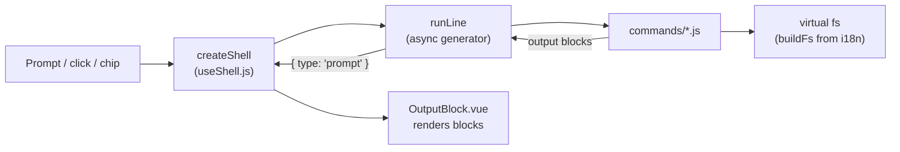

# leonel-os

[](https://github.com/LeonelRosado2407/portfolio-terminal/actions/workflows/ci.yml)
[](LICENSE)
[](https://os.leonelrosado.dev)

My portfolio as an operating system. It boots, logs in as `root` and drops you into a terminal where you can explore my projects, experience and contact info with `ls`, `cd`, `cat` and `open`. Or skip the commands and just click.

**→ [os.leonelrosado.dev](https://os.leonelrosado.dev)**


## Features

- **Fake Linux boot** with a typed `root` login and a `neofetch`-style banner. Any key skips it, returning visitors get a short version, and `prefers-reduced-motion` skips it entirely.
- **A real-feeling shell**: virtual filesystem, `&&` chaining, zsh-style errors (`too many arguments`, `no such file or directory`), "did you mean…?", history with ↑/↓, Tab completion.
- **IntelliSense-style suggestions** while typing: commands with descriptions, paths filtered per command (`cd` only offers folders), and known values for `lang` and `theme`.
- **Usable without typing**: every `ls` entry, "next step" and quick-command chip is clickable, so recruiters can browse with the mouse or on a phone.
- **Project galleries** with a full-screen, keyboard-accessible image viewer.
- **Contact form inside the terminal** (`send-message`), with validation and a `mailto:` fallback. Sent through Web3Forms.
- **English / Spanish** (`lang es`) and **4 color themes** (`theme dracula`). The browser-tab icon follows the theme.
- **Accessible**: `role="log"` output, a combobox-pattern prompt, visible focus, AA contrast in every palette, a `<noscript>` fallback.
- A few hidden commands. Try `matrix`.

## Architecture

The shell core is plain JavaScript with no Vue and no DOM. That keeps it small, fast to test and easy to reason about. Vue only renders what the core produces.



- **`src/os/`** is the pure core:
  - `fs/buildFs.js` builds a Unix-like tree (`~/projects`, `~/experience`, …) from the i18n messages, so every file is translated and paths never depend on the language.
  - `shell/run.js` runs a line as an **async generator**. It yields typed output blocks (`text`, `list`, `table`, `gallery`, …), and interactive commands yield `{ type: 'prompt' }` and get the user's answer back from `next()`. That one protocol drives the contact form, `&&` chains and cancellation (`gen.return()` on Ctrl+C).
  - `commands/*.js` are declarative: `{ name, summary, args | paths, maxArgs, run(ctx, args) }`. The same metadata powers argument limits, Tab completion and suggestions.
  - Commands never touch `window`; all side effects (open a URL, download, change theme…) go through an injected `ctx`, so the tests use a fake one.
- **`src/composables/useShell.js`** turns the core into Vue state: cwd, output lines, history, the pending prompt and the intro animation.
- **`src/components/`** only renders output blocks (never `v-html`), plus the boot screen, the image viewer and the matrix rain.

## Tech stack

Vue 3 (`<script setup>`, plain JavaScript) · Vite 5 · Tailwind CSS 3 · vue-i18n 11 · Vitest · Playwright · ESLint + Prettier · GitHub Actions · Vercel

## Getting started

```bash
npm install
npm run dev          # http://localhost:5173
```

Copy `.env.example` to `.env` and set `VITE_WEB3FORMS_KEY` if you want `send-message` to deliver mail locally.

| Script                                  | What it does                                                                     |
| --------------------------------------- | -------------------------------------------------------------------------------- |
| `npm run dev`                           | Vite dev server                                                                  |
| `npm run build` / `npm run preview`     | Production build and local preview                                               |
| `npm test`                              | Unit tests (Vitest): shell core, filesystem, commands, completion, shell state   |
| `npm run test:e2e`                      | End-to-end tests (Playwright) on desktop and phone, against the production build |
| `npm run lint` / `npm run format:check` | ESLint and Prettier checks (`lint:fix` / `format` to apply)                      |

## Testing

- **Unit (Vitest)**: the core runs in Node with real translations. Unknown i18n keys throw, so a typo fails the build.
- **End-to-end (Playwright)**, on desktop Chrome and a Pixel 5:
  - boot variants and reduced motion
  - click-only navigation, the gallery and image viewer
  - suggestions and history
  - the contact form (the Web3Forms API is mocked, so tests never send mail)
  - theme and language persistence, mobile layout, and the matrix rain
- **CI** runs lint, format, unit tests, the build and the E2E suite on every push and pull request.

## Deploy (Vercel)

This is its own Vercel project, separate from the v1 portfolio at leonelrosado.dev.

1. Vercel → **Add New → Project** → import `LeonelRosado2407/portfolio-terminal`.
2. Name the project `leonel-os`. `vercel.json` already sets the Vite build, so the remaining settings can stay at their defaults.
3. **Environment Variables:** add `VITE_WEB3FORMS_KEY` for Production and Preview.
4. Deploy, then go to **Settings → Domains** and add `os.leonelrosado.dev`.
5. Turn on **Analytics** in the project (the app already calls `inject()`).

If the domain ever changes, update the `canonical`, `og:url`, `og:image` and `twitter:image` URLs in `index.html`, plus `public/robots.txt` and `public/sitemap.xml`.

## License

The **code** is released under the [MIT License](LICENSE). Feel free to learn from it or build your own terminal portfolio.

The **personal content** is not covered by that license and remains © Leonel Rosado. That includes my CV files, the texts about me and my work, and the project screenshots. Please don't publish it as your own.
